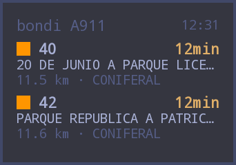
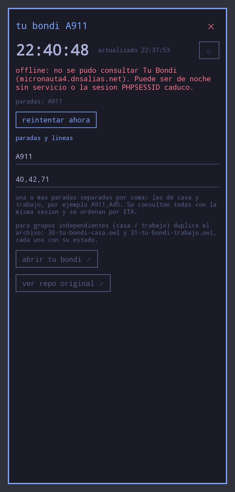
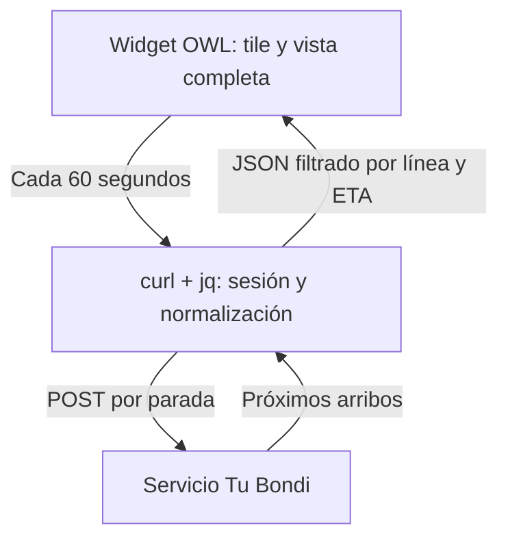

# Tu Bondi · Oma

**Los próximos colectivos de Córdoba, directamente en tu pantalla de inicio.**

Un widget [OWL para omalauncher](https://github.com/SimonSchubert/omarchy-widgets) que consulta los arribos de Tu Bondi sin instalar un backend .NET. Elegí tus paradas y líneas desde el propio widget y consultá los próximos colectivos de un vistazo.

<p align="center">
  
  
</p>

<p align="center"><sub>Capturas del widget incluidas en el repositorio, generadas mediante owl-check.</sub></p>

**Por defecto:** parada A911 (Av. Duarte Quirós 1717–1728), líneas 40, 42 y 71. Podés agregar varias paradas y filtrar entre las líneas disponibles sin escribir códigos.

> [!NOTE]
> Este proyecto es el widget de [Tu-Bondi-Tracker](https://github.com/LucioB16/Tu-Bondi-Tracker). Consulta la misma fuente de datos, pero desde OWL y comandos locales. Los arribos dependen de la disponibilidad del servicio de Tu Bondi.

## Requisitos previos

- Un entorno con **omalauncher y ejecución de comandos Linux**: el widget usa `cmd`.
- En Arch: `curl` y `jq` (declarados en `requires { pacman: ["curl", "jq"] }`).
- Acceso a Internet a `https://micronauta4.dnsalias.net`.

## Instalación

1. Copiá el widget a tu home-screen:
   ```
   cp widget.owl ~/.config/omalauncher/widgets/30-tu-bondi.owl
   ```
   Aparece en la home en ~1 segundo.
2. Copiá el catálogo de paradas (5050 paradas con barrio, lo usa el buscador):
   ```
   cp api-examples/tubondi-catalogo.json ~/.cache/tubondi-catalogo.json
   ```
   Sin ese archivo el widget usa 32 paradas de muestra.
3. Instalá lo que declara:
   ```
   pacman -S --needed curl jq
   ```
4. Verificá que compila y mirá el preview con datos vivos:
   ```
   owl-check 30-tu-bondi.owl
   ```
   Imprime los errores y la ruta del PNG del tile (y de su screen, porque tiene una). Abrilos para ver si el texto entra.

## Configurá tus paradas y líneas

1. Instalá el widget (ver abajo) y **tocá el tile** para abrir la vista completa.
2. Bajá a **configurar** → pestaña **paradas**: tocá los códigos de tu barrio (se ponen verdes y entran en "mis paradas"). Agregá los de casa y los del trabajo, por ejemplo `A911` + `CE56`.
3. Pestaña **líneas**: tocá las que te sirven, o una empresa entera (`todas coniferal`), o dejá **todas las lineas** para ver todo lo que pasa por tus paradas.
4. Listo: el tile muestra los 2 arribos más próximos entre todas tus paradas. Todo persiste entre reinicios.

Opciones extra en la pestaña **manual**: escribir códigos a mano (`A911,A45`), duplicar el archivo para grupos independientes (`30-tu-bondi-casa.owl` + `31-tu-bondi-trabajo.owl`), y links a Tu Bondi web y al repo original.

## Qué muestra el widget

La implementación está en un solo archivo (`widget.owl`) y adapta el tablero LED del proyecto original:

- Fila superior: parada(s) + reloj (se actualiza cada 30 s). Con varias paradas muestra `bondi ×N`.
- Fila central: próximos 2 arribos en el tile (hasta 6 en la vista completa, mezclando todas las paradas y ordenados por ETA), con línea, parada, destino, distancia, empresa y minutos restantes. Si hay `notificacion`, muestra fila de alerta amarilla.
- Fila inferior: “actualizado HH:mm”.
- Vista completa (`screen`, toca el tile): arribos agrupados por parada con detalle, avisos, reloj HH:mm:ss y configuración de paradas/líneas con `Input` (persisten entre reinicios).
- Sin servicio (de noche o API caída): muestra “offline / sin arribos” y botón de reintentar, igual que el manejo de errores del backend original.

## ¿Cómo funciona (de punta a punta)?



1. El `cmd` abre sesión con `GET /usuario/urbano.php?conf=cbaciudad` (cookie `PHPSESSID` en cookiejar temporal), extrae `operacion:'…'` del HTML, registra un `fp` aleatorio vía `POST ...?cmd=vista` y luego hace **un `POST /usuario/urbano2_cmd.php` por parada** con headers de browser + `X-Device-FlakerParam` y form `conf`, `codigo`, `show80min=true`, `onlygps_array={}`, `cmd=proximos_arribos` — los mismos parámetros que `TuBondiClient.GetArrivalsAsync` en el repo original, más el ritual anti-408 que exige el servidor (ver `docs/api.md`). Una sola sesión sirve para todas.
2. `jq` normaliza cada `proximos_arribos` a `{line, dest, route, etaTxt, eta, dist, color, op, notif}` más `stop`, y combina todo en `{stops, arrivals, updated, error}`. `eta` se extrae igual que `TuBondiGateway.ParseEta`: “arribando/llega” → 0, si no los dígitos (`11min` → 11).
3. El widget filtra por las líneas configuradas, ordena por `eta` y toma 6 (2 en el tile; con varias paradas cada fila indica `línea · parada`).
4. Si el POST falla o no es JSON, el script imprime `{"error":"offline",...}` y el tile ofrece reintentar, como el `fetchLoop` de `board.js`.

## Catálogo de paradas y líneas

- **Paradas**: `api-examples/tubondi-catalogo.json` — **5050 paradas** en 408 barrios + 24 hubs (cruce de `seleccionatraza` de las 160 rutas con los polígonos oficiales de barrios). El widget trae buscador por código/calle/barrio, botones de hubs y chips de "mis paradas". (`catalogo-semilla.json` guarda el primer cruce de 79 paradas.)
- **Líneas**: las 72 de `api-examples/01-lines_routes.json` (actualizado 2026-10-12: incluye **Sol Bus** con 70–76), agrupadas por empresa (TAMSE, CONIFERAL, SI BUS, SOL BUS) con botones de filtro.
- **Para regenerar el catálogo**: corré `./tools/cosechar-paradas.sh` (receta anti-408 incluida: página → `operacion` → registro `fp` → POSTs), que guarda `api-paradas/` + `paradas-todas.json`, y luego cruzá con `python3 tools/unir-barrios.py` usando `cordoba.geojson` de https://github.com/OpenDataCordoba/barrios.

## Configuración manual

Sin editar el archivo: abrí la vista completa (tocá el tile) y cambiá las paradas y las líneas en los campos (se guardan con `persist`):

- Paradas: `A911` — una o más, separadas por coma: las de casa y trabajo, por ejemplo `A911,A45`.
- Líneas: `40,42,71`

Equivalente a las variables del repo original (`Tracker__StopCode`, `Tracker__Lines`). El intervalo de refresco es 60 s (el original usa 25 s con caché de 12 s; en el widget se espacia para no sobrecargar la API municipal) y el reloj va cada 30 s.

Para grupos independientes (casa / trabajo con líneas distintas) duplicá el archivo: `30-tu-bondi-casa.owl` y `31-tu-bondi-trabajo.owl` — cada copia guarda su propio estado.

## Uso del tablero

- Tile: próximos 2 arribos (de todas las paradas, ordenados por ETA) + aviso + hora de actualización. Tocarlo abre la vista completa.
- Screen: arribos agrupados por parada con empresa, distancia y avisos; hora actual y de actualización; campos de paradas/líneas; botones a Tu Bondi web y al repo original.
- Si la API devuelve `notificacion`, se muestra como fila amarilla (igual que la fila verde intermitente del LED original).

## Pruebas

```
owl-check 30-tu-bondi.owl
```

Criterios (igual que los xUnit del repo original, adaptados):

- El `jq` mapea `api-examples/06-arrivals.json` a arribos con `eta` 11/21/49.
- Filtra por líneas y ordena por ETA con tope de 6.
- Sin red o con `408` (de noche la API corta) muestra “offline” y conserva el mensaje, no rompe el tile.
- `curl` y `jq` están en `requires` y el `.errors/` no advierte programas sin declarar.

Para probar el layout con datos aunque la API esté caída, este repo trae `api-examples/06-arrivals.json` (el mismo ejemplo del repo original).

## Buenas prácticas y límites

- **Etiqueta**: el script usa `User-Agent: TuBondi-Tracker-Widget/1.0`.
- **Caching**: refresco cada 60 s (más espaciado que los 10–15 s del backend).
- **Rate limiting**: un solo comando a la vez; si falla, espera al próximo intervalo o toca reintentar.
- **Privacidad**: la cookie `PHPSESSID` vive en un `mktemp` que se borra en cada corrida. Nunca se expone.
- **Seguridad**: siempre HTTPS contra `micronauta4.dnsalias.net`.

## Preguntas frecuentes

**No se muestra nada / dice offline**

- De noche la API municipal devuelve `408` vacío (verificado 22:30 ART). Esperá al horario de servicio y tocá reintentar.
- Verificá con `curl` que `GET /web/urbano/?conf=cbaciudad` devuelva 200.

**¿Cómo agrego otra línea o parada?**

- En la vista completa cambiá los campos (paradas separadas por coma), o editá los `state` por defecto (`stopsStr`, `linesStr`) en `widget.owl`.

**¿Problemas con la cookie / sesión?**

- El script reabre la sesión en cada corrida (no la reutiliza entre intervalos), así que una `PHPSESSID` vencida se renueva sola.

## Créditos y referencias

- Repo original: https://github.com/LucioB16/Tu-Bondi-Tracker
- Fuente de datos Tu Bondi: https://micronauta4.dnsalias.net/web/urbano/?conf=cbaciudad
- Lenguaje de widgets OWL: ver `README.md` de `~/.config/omalauncher/widgets`

## Licencia

GPL-3.0-only. Ver `LICENSE`.
